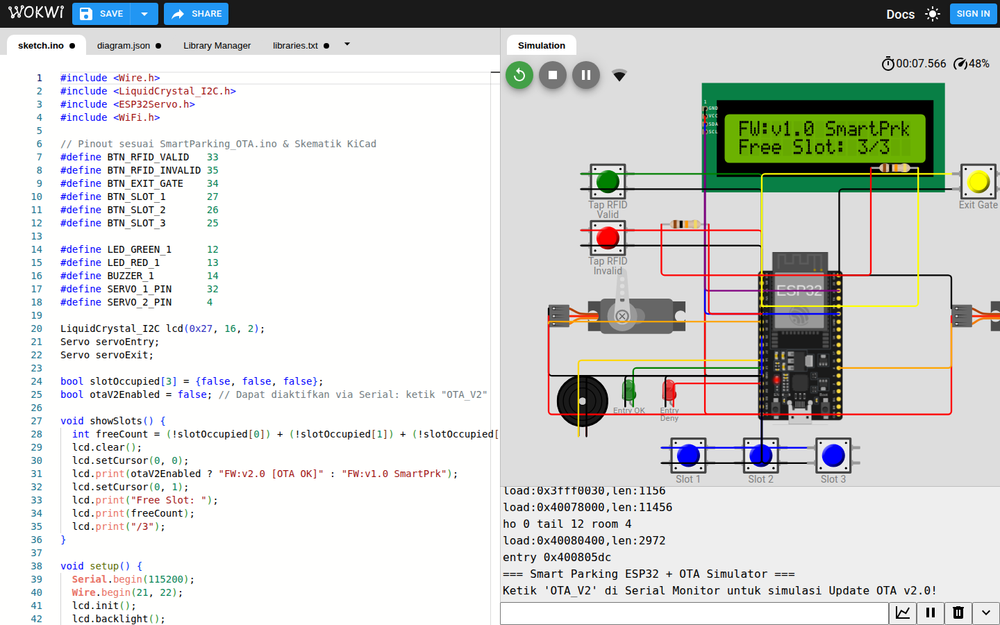
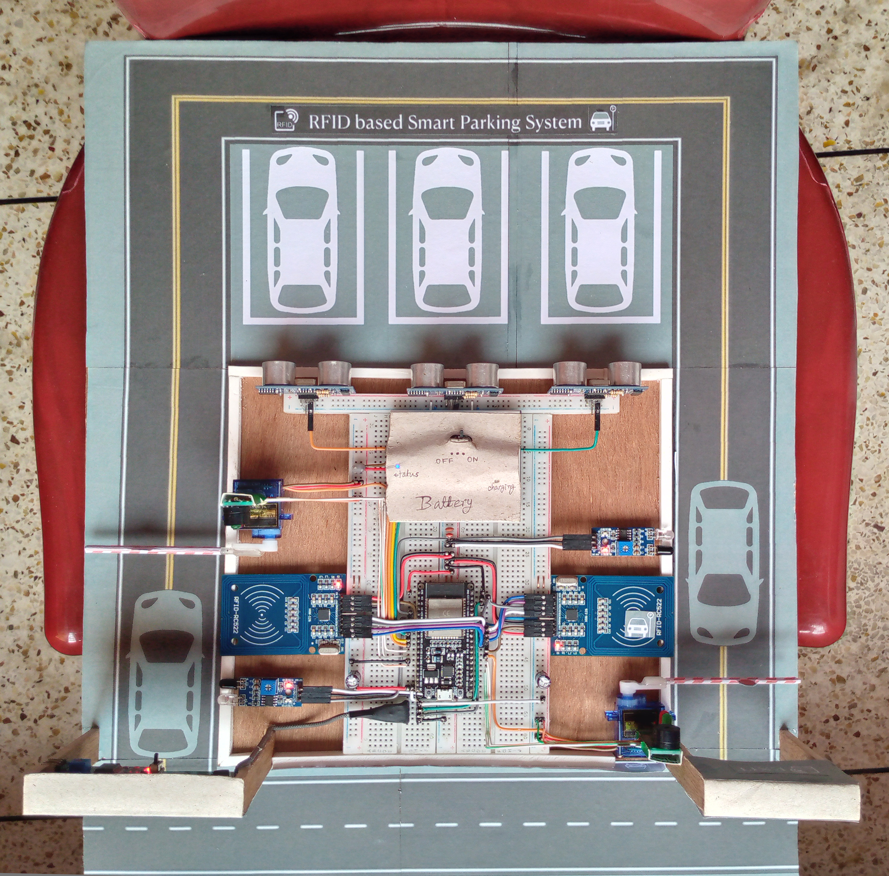

# Smart Parking System IoT (ESP32 + OTA)

Sistem parkir pintar berbasis **ESP32 DevKit V1** dengan Dual RFID MFRC522, sensor slot parkir, palang servo, LCD 16×2 I2C, dan pembaruan firmware nirkabel **Over-The-Air (OTA)** menggunakan `AsyncElegantOTA`.

---

## Mengapa Berkelanjutan & Wajib OTA?
* **Multi-Node di Lapangan:** Gerbang masuk/keluar dan sensor slot terpasang permanen di area parkir (tidak praktis dihubungkan kabel USB satu per satu).
* **Aturan Dinamis:** Tarif, *whitelist* kartu RFID, dan logika *full-slot lock* terus berubah setelah alat dipasang.
* **Evolusi Firmware:** `v1.0` (RFID & monitoring dasar) → `v2.0` via OTA (*Full-Slot Lock*) → `v3.0` via OTA (MQTT Cloud & QRIS).

---

## Referensi Jurnal
1. **Cyberpark: An-IoT based Automated Parking Management and Monitoring System using RFID and ESP32** (*Journal of Computing Research and Innovation*, 2025) — [ResearchGate](https://www.researchgate.net/publication/402923837_Cyberpark_An-IoT_based_Automated_Parking_Management_and_Monitoring_System_using_RFID_and_ESP32)
2. **Program Modification On The NodeMCU Using The Over The Air (OTA) Method** (*TELECTRICAL*, 2024) — [PDF](https://jurnal.untan.ac.id/index.php/TELECTRICAL/article/view/84927/pdf)

---

## Skematik & Simulasi

### 1. Skematik KiCad (Fedora Linux)
File: [`hardware/kicad/SmartParking_ESP32_OTA.kicad_pro`](hardware/kicad/SmartParking_ESP32_OTA.kicad_pro)

### 2. Simulasi Live di Wokwi (`wokwi.com`)
File: [`simulation/wokwi/`](simulation/wokwi/) (`diagram.json`, `sketch.ino`, `libraries.txt`)

### 3. Pinout ESP32

| Subsistem | Komponen | Pin GPIO ESP32 |
| :--- | :--- | :--- |
| **SPI Bus** | MFRC522 MOSI / MISO / SCK | `23`, `19`, `18` |
| **I2C Bus** | LCD 16×2 I2C (`0x27`) | `21` (SDA), `22` (SCL) |
| **Entry Gate** | RFID 1 (`SS`/`RST`), IR, Servo 1, LED, Buzzer | `17`, `33`, `35`, `32`, `12`, `13`, `14` |
| **Exit Gate** | RFID 2 (`SS`/`RST`), IR, Servo 2, LED, Buzzer | `5`, `16`, `34`, `4`, `2`, `0`, `15` |
| **Parking Slots** | Sensor Slot 1, 2, 3 | `27`, `26`, `25` |

---

## Dokumentasi Foto, Video & Presentasi

| Perakitan & Wiring | Prototipe Final |
| :---: | :---: |
|  |  |

* **Video Simulasi Asli Wokwi:** [`docs/video/SmartParking_Wokwi_Real_Simulation.mp4`](docs/video/SmartParking_Wokwi_Real_Simulation.mp4)
* **Video Demo OTA:** [`docs/video/SmartParking_OTA_Live_Simulation_Demo.mp4`](docs/video/SmartParking_OTA_Live_Simulation_Demo.mp4)
* **Presentasi Interaktif (Siap Import Canva):** [`presentation/SmartParking_IoT_OTA_Canva_Interactive.pptx`](presentation/SmartParking_IoT_OTA_Canva_Interactive.pptx)
* **Presentasi Web:** [`presentation/index.html`](presentation/index.html)

---

## Cara Update Firmware OTA
1. Unggah [`firmware/SmartParking_OTA.ino`](firmware/SmartParking_OTA.ino) awal (`v1.0`) via USB.
2. Di Arduino IDE, pilih **Sketch → Export Compiled Binary** (`.bin`).
3. Buka `http://<IP-ESP32>/update`, unggah file `.bin` baru, dan ESP32 akan *reboot* otomatis ke versi terbaru.
