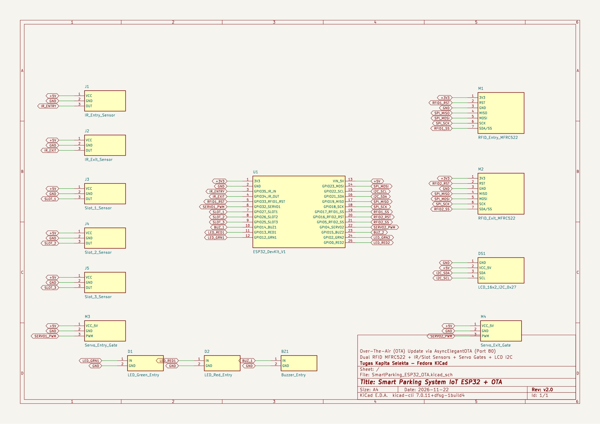
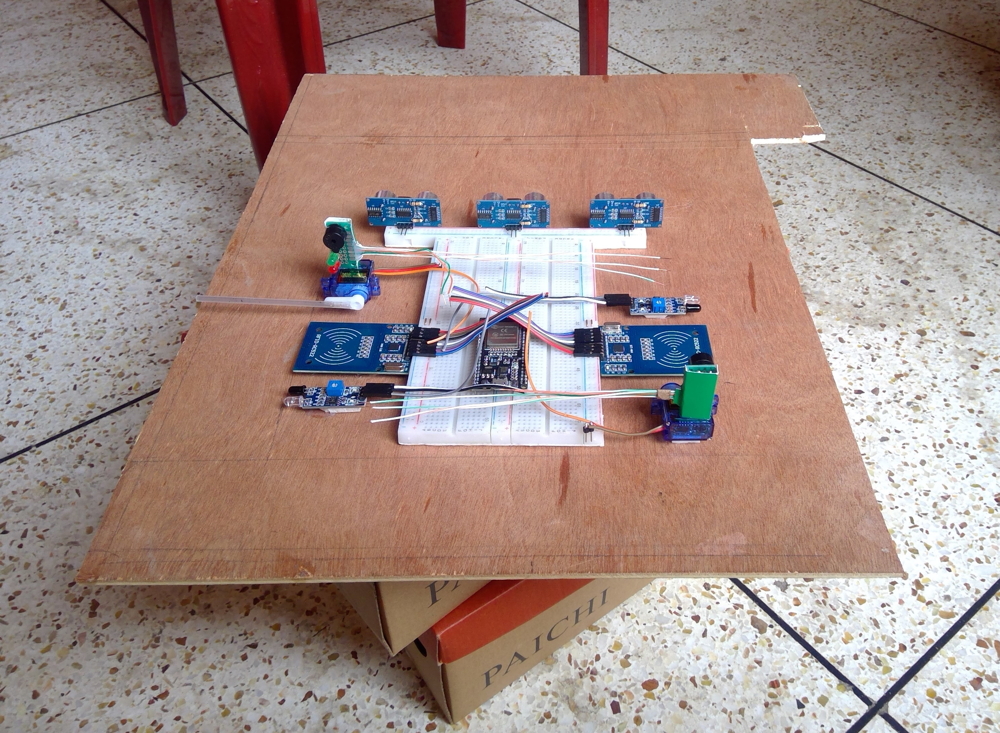
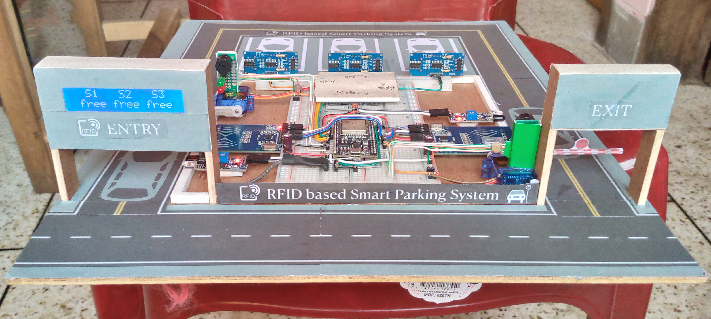
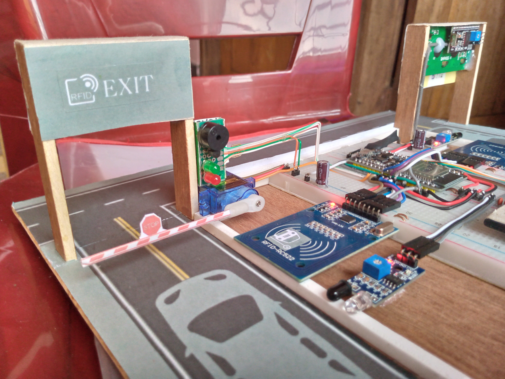
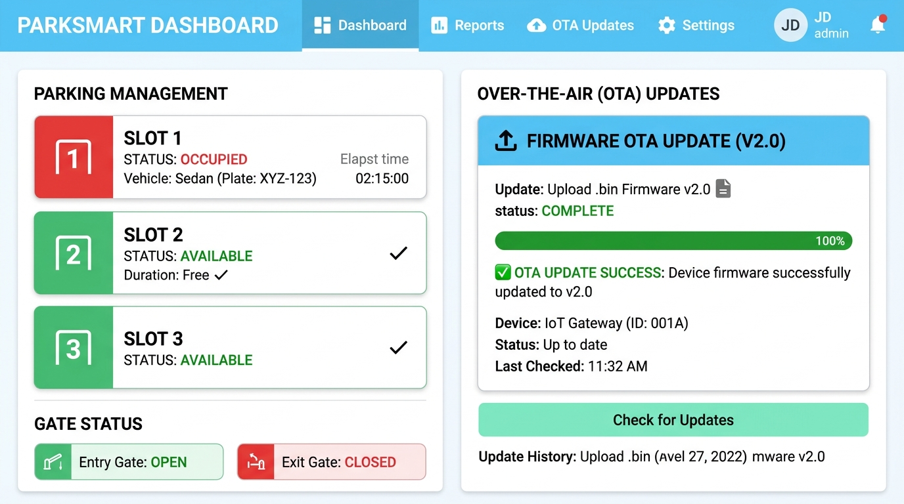

# 🚗 Smart Parking System IoT Berbasis ESP32 dengan Fitur Over-The-Air (OTA) Firmware Update

[](#)
[](#)
[](#)
[-294172?style=flat-square)](#)

Repositori ini berisi dokumentasi lengkap, skematik rangkaian (**KiCad untuk Fedora Linux** & **Proteus `.pdsprj`**), kode firmware (**ESP32 + FreeRTOS + AsyncElegantOTA**), dokumentasi foto, presentasi interaktif bergaya Canva, serta video presentasi untuk proyek **Smart Parking System IoT yang mendukung pembaruan firmware nirkabel Over-The-Air (OTA)**.

---

## 📌 Mengapa Proyek Ini Berkelanjutan & Wajib Menggunakan OTA?

Berbeda dengan alat portabel/personal statis (seperti alat deteksi detak jantung yang logikanya tetap dan mudah diakses kabel USB), **Smart Parking System** memiliki karakteristik sistem IoT yang **berkelanjutan (*sustainable*)**:

1. **Multi-Node & Tersebar di Lapangan:** Gerbang masuk, gerbang keluar, dan sensor slot parkir terpasang permanen di area parkir (outdoor/basement), sehingga tidak praktis jika teknisi harus mencolokkan kabel USB satu per satu ke setiap mikrokontroler.
2. **Aturan Bisnis Dinamis:** Logika sistem parkir terus berkembang pasca-implementasi, misalnya pembaruan tarif progresif, kuota *member*, *whitelist* kartu RFID, hingga durasi buka-tutup palang otomatis.
3. **Ekspansi Fitur Jangka Panjang:**
   * **Firmware v1.0:** Autentikasi Dual RFID MFRC522 + monitoring 3 slot parkir pada Web Server lokal.
   * **Firmware v2.0 (via OTA):** Penambahan fitur *Full-Slot Lock* (otomatis menolak akses masuk jika semua slot penuh) dan pembaruan dashboard tanpa membongkar perangkat keras.
   * **Firmware v3.0 (via OTA):** Integrasi broker MQTT cloud & pembayaran QRIS.

---

## 📚 Referensi Jurnal Ilmiah & Sumber Proyek

1. **Jurnal Utama Sistem Smart Parking (ESP32 + RFID):**
   * *Cyberpark: An-IoT based Automated Parking Management and Monitoring System using RFID and ESP32* — Journal of Computing Research and Innovation, Vol. 10 No. 2 (2025).
   * Tautan: [ResearchGate - Cyberpark RFID & ESP32](https://www.researchgate.net/publication/402923837_Cyberpark_An-IoT_based_Automated_Parking_Management_and_Monitoring_System_using_RFID_and_ESP32)
2. **Jurnal Pendukung Mekanisme OTA (AsyncElegantOTA):**
   * *Program Modification On The NodeMCU Using The Over The Air (OTA) Method* — Jurnal TELECTRICAL, Universitas Tanjungpura (2024).
   * Tautan PDF: [jurnal.untan.ac.id/index.php/TELECTRICAL/article/view/84927/pdf](https://jurnal.untan.ac.id/index.php/TELECTRICAL/article/view/84927/pdf)
3. **Repositori Referensi Hardware & Proteus:**
   * [Muhaiminul-Hasan/RFID-based-Smart-Parking-System-using-ESP32](https://github.com/Muhaiminul-Hasan/RFID-based-Smart-Parking-System-using-ESP32)

---

## 🗂️ Struktur Repositori

```text
tugaskapita/
├── README.md                                      # Dokumentasi utama proyek
├── firmware/
│   ├── SmartParking_OTA.ino                       # Firmware lengkap ESP32 (FreeRTOS + WebServer + OTA)
│   └── Basic_OTA.ino                              # Sketch minimal pengujian OTA
├── hardware/
│   ├── kicad/
│   │   ├── SmartParking_ESP32_OTA.kicad_pro       # Proyek KiCad 7/8 (Fedora Linux)
│   │   └── SmartParking_ESP32_OTA.kicad_sch       # File skematik KiCad asli
│   └── proteus/
│       └── SPS_circuit_diagram.pdsprj             # File skematik Proteus 8 Professional
├── docs/
│   ├── images/
│   │   ├── kicad_schematic.png                    # Screenshot hasil export KiCad CLI
│   │   ├── hardware_wiring.jpg                    # Foto perakitan & wiring
│   │   ├── hardware_final_1.jpg                   # Foto prototipe final (tampak keseluruhan)
│   │   ├── hardware_final_2.jpg                   # Foto prototipe final (gerbang & RFID)
│   │   ├── hardware_final_3.jpg                   # Foto prototipe final (area slot parkir)
│   │   └── ota_dashboard_preview.jpg              # Preview dashboard monitoring & panel OTA
│   └── video/
│       └── SmartParking_IoT_OTA_Presentation.mp4  # Video presentasi & dokumentasi proyek
└── presentation/
    └── index.html                                 # Presentasi interaktif cerah ala Canva
```

---

## 🔌 Pemetaan Pinout ESP32 DevKit V1

| Kategori | Komponen | Pin ESP32 (GPIO) | Keterangan |
| :--- | :--- | :--- | :--- |
| **SPI Bus** | MFRC522 MOSI / MISO / SCK | `GPIO 23`, `GPIO 19`, `GPIO 18` | Bus SPI bersama untuk RFID Entry & Exit |
| **I2C Bus** | LCD 16×2 I2C (`0x27`) | `GPIO 21` (SDA), `GPIO 22` (SCL) | Menampilkan status akses & ketersediaan slot |
| **Entry Gate** | RFID 1 (`SS` / `RST`) | `GPIO 17` / `GPIO 33` | Autentikasi kartu RFID gerbang masuk |
| **Entry Gate** | IR Sensor + Servo 1 | `GPIO 35` / `GPIO 32` | Deteksi kendaraan masuk & aktuator palang |
| **Entry Gate** | LED Hijau / Merah + Buzzer | `GPIO 12`, `GPIO 13`, `GPIO 14` | Indikator akses masuk diterima/ditolak |
| **Exit Gate** | RFID 2 (`SS` / `RST`) | `GPIO 5` / `GPIO 16` | Autentikasi kartu RFID gerbang keluar |
| **Exit Gate** | IR Sensor + Servo 2 | `GPIO 34` / `GPIO 4` | Deteksi kendaraan keluar & aktuator palang |
| **Exit Gate** | LED Hijau / Merah + Buzzer | `GPIO 2`, `GPIO 0`, `GPIO 15` | Indikator akses keluar diterima/ditolak |
| **Parking Slots** | Sensor Slot 1, 2, 3 | `GPIO 27`, `GPIO 26`, `GPIO 25` | Deteksi status terisi/kosong tiap slot |

---

## 📐 Dokumentasi Skematik (KiCad di Fedora & Proteus)

### 1. Skematik KiCad (`hardware/kicad/SmartParking_ESP32_OTA.kicad_sch`)
Skematik dibuat dalam format **KiCad 7/8** sehingga dapat dibuka, diedit, dan diekspor langsung di **Fedora Linux** (`sudo dnf install kicad`).



**Cara Membuka di Fedora Linux:**
```bash
kicad hardware/kicad/SmartParking_ESP32_OTA.kicad_pro
```

### 2. Skematik Proteus (`hardware/proteus/SPS_circuit_diagram.pdsprj`)
File `.pdsprj` tersedia di folder `hardware/proteus/` untuk validasi rangkaian elektronika di Proteus 8 Professional.
> **Catatan:** Proteus memvalidasi rangkaian sensor, aktuator servo, LED, dan LCD I2C. Pengujian jaringan Wi-Fi dan proses unggah `.bin` OTA dijalankan pada perangkat ESP32 fisik.

### 3. Simulasi Interaktif Online & Bisa Langsung Dites (Wokwi — Support Fedora Linux)
Agar skema dan kode ESP32 **dapat langsung dites berjalan secara real-time** tanpa kendala OS/library Proteus, proyek ini juga dilengkapi paket simulasi **Wokwi** di [`simulation/wokwi/`](simulation/wokwi/):
* [`simulation/wokwi/diagram.json`](simulation/wokwi/diagram.json) — Rangkaian ESP32 DevKit, LCD 16×2 I2C, 2× Servo SG90, LED, Buzzer, dan tombol simulasi RFID/Slot.
* [`simulation/wokwi/sketch.ino`](simulation/wokwi/sketch.ino) — Firmware siap jalan (termasuk simulasi update OTA `v1.0 → v2.0` melalui Serial Monitor dengan mengetik `OTA_V2`).
* [`simulation/wokwi/libraries.txt`](simulation/wokwi/libraries.txt) — Daftar library otomatis (`LiquidCrystal I2C`, `ESP32Servo`).

**Cara Menjalankan Tes di Browser (Wokwi):**
1. Buka [wokwi.com](https://wokwi.com/projects/new/esp32) di browser Fedora Anda.
2. Salin isi `sketch.ino` ke tab kode, `diagram.json` ke tab `diagram.json`, dan `libraries.txt` ke tab Library Manager.
3. Klik tombol **Play (▶)** — uji klik tombol **Tap RFID Valid/Invalid**, **Slot 1–3**, **Exit Gate**, serta ketik `OTA_V2` di Serial Monitor untuk menguji perubahan logika firmware `v2.0`!

---

## 📸 Dokumentasi Foto Perangkat Keras & Dashboard OTA

| Perakitan & Wiring | Prototipe Final (Keseluruhan) |
| :---: | :---: |
|  |  |

| Gerbang & Sensor Parkir | Area Slot & Indikator |
| :---: | :---: |
|  |  |

### Antarmuka Web Dashboard & Panel OTA (`AsyncElegantOTA`)


---

## 🎬 Dokumentasi Video & Presentasi Interaktif

* **Video Rekaman Simulasi Asli di Wokwi (`.mp4`):** [`docs/video/SmartParking_Wokwi_Real_Simulation.mp4`](docs/video/SmartParking_Wokwi_Real_Simulation.mp4) *(rekaman langsung compile, boot ESP32, LCD 16×2 I2C, tombol, dan Serial Monitor di `wokwi.com`)*
* **Screenshot Simulasi Wokwi:** [`docs/images/wokwi_simulation_running.png`](docs/images/wokwi_simulation_running.png)
* **Presentasi Interaktif Siap Import Canva (`.pptx`):** [`presentation/SmartParking_IoT_OTA_Canva_Interactive.pptx`](presentation/SmartParking_IoT_OTA_Canva_Interactive.pptx) *(10 slide cerah dengan tombol navigasi interaktif antar-slide — tinggal upload/import ke Canva!)*
* **Presentasi Interaktif Web (HTML):** [`presentation/index.html`](presentation/index.html)

---

## 🚀 Cara Menjalankan & Melakukan Update OTA

1. Buka [`firmware/SmartParking_OTA.ino`](firmware/SmartParking_OTA.ino) di **Arduino IDE** (atau PlatformIO).
2. Sesuaikan `ssid` dan `password` Wi-Fi pada baris 15–16.
3. Unggah firmware awal (**v1.0**) melalui kabel USB untuk mengaktifkan Web Server dan endpoint OTA.
4. Untuk pembaruan **v2.0** tanpa kabel:
   * Di Arduino IDE, pilih **Sketch → Export Compiled Binary** untuk menghasilkan file `.bin`.
   * Buka browser dan akses `http://<IP-ESP32>/update`.
   * Pilih file `.bin` baru dan klik **Upload**. ESP32 akan memperbarui flash secara nirkabel dan melakukan *auto-reboot*.
